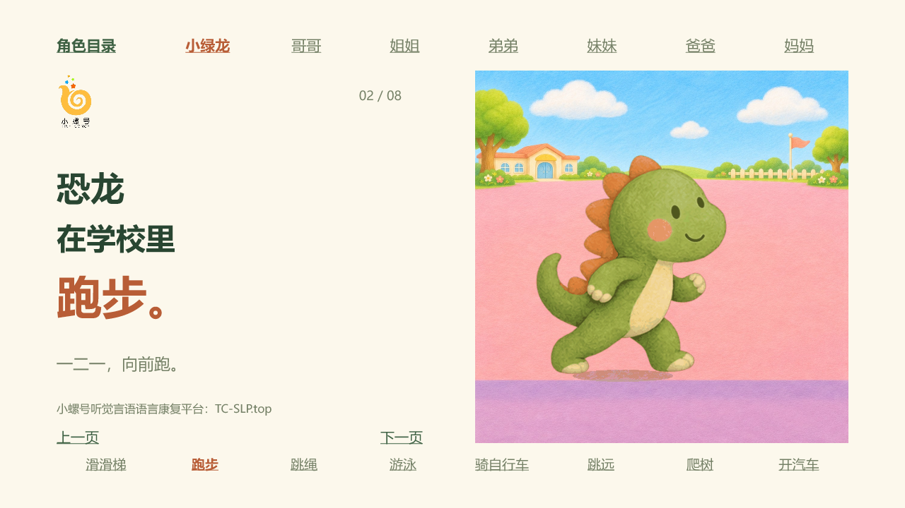
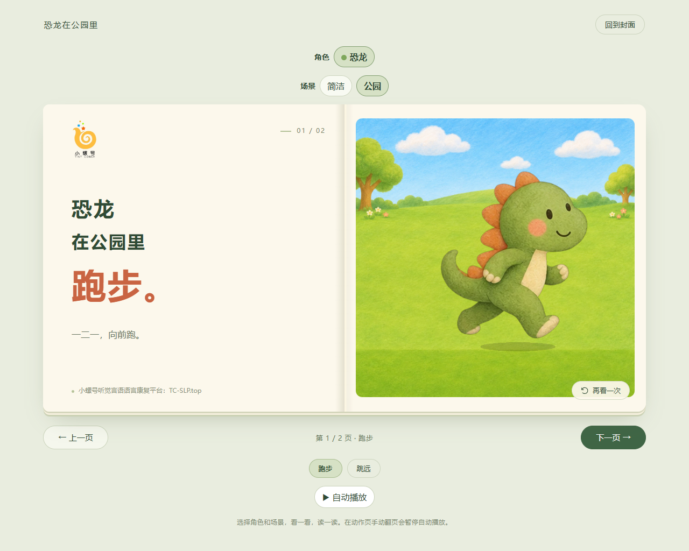

# 小螺号动画书 Skill

**把仓库链接丢给 AI 安装，一句话制作会动的绘本。**

为老师制作动作词、人物与场景绘本：角色有连续姿态变化，文字可以编辑，页面可以翻动。默认交付本地动画 PPTX；也支持离线 HTML 互动版。


*GIF 为已有动画书中嵌入的原始多帧动作文件。下面另附 PPT 页面渲染和 HTML 浏览器截图；GIF 不是 PowerPoint 放映录屏。*

## 老师从这里开始

1. 在你使用的 **AI Agent** 中打开一个工作文件夹。各类 AI Agent 都可以使用这套流程；由 Agent 检查本地文件、命令、生图和导出能力，并按自己的技能机制安装或加载。Codex 只是其中一个示例；普通网页聊天框收到链接不等于已安装到电脑。
2. 把下面的安装口令完整复制给 AI。也可以直接发送 [AI 自动安装说明](aizidonganzhuangskill.md) 的链接。
3. 安装后在下一轮消息点名技能，并说出绘本主题、动作和输出格式。

### 第一句：让 AI 安装

```text
请从 https://github.com/Jack-the-slp/xiaoluohao-animated-book 安装小螺号动画书 skill。
先读取仓库的 aizidonganzhuangskill.md，按你自己的 Agent 环境选择安装或加载方式，保留已有同名技能，
安装依赖并运行随附小样；告诉我实际安装位置、检查结果和还缺什么。
```

### 第二句：生成自己的绘本

```text
用小螺号动画书 skill 做一本《小兔在幼儿园》，包含跑步、跳远、洗手、吃饭四个动作，
温暖水彩风，使用“谁／在哪里／做什么”三行短句，直接给我可编辑的本地动画PPTX。
```

想要网页互动版，就说：

```text
用动画书 skill 做一本《恐龙在公园里》，包含跑步和跳远，给我能离线打开、
能翻页和重播的HTML互动绘本，文字简短。
```

“一句话”是需求入口。AI 仍需要生成并检查姿态图、组装文件和验收；完成时间与图片生成能力、页数有关。这个仓库提供工作流和构建脚本，不提供免费的生图服务或模型账号。

## 先看实际效果



*已有 PPT 文件的页面渲染：文字与动画分开，留白和导航保留在安全区。*



- [下载并体验离线 HTML 小样](examples/demo.html)：下载原始文件后用现代浏览器打开，包含恐龙跑步、跳远和两种场景。
- [教师逐步安装教程](docs/installation.md)：自动安装、下载 ZIP 手动安装、第一次使用及常见问题。
- [给 AI 的自动安装说明](aizidonganzhuangskill.md)：可直接把链接发给 AI。
- [验证覆盖与限制](docs/validation.md)：分清文件检查、浏览器操作和真实播放器验证。

## 需要什么

| 任务 | 所需环境 | 能得到什么 |
| --- | --- | --- |
| 体验随附小样 | 现代浏览器 | 离线 HTML，不需要模型账号 |
| 从已有素材构建 HTML | Python 3.10+、Pillow | 单文件 HTML、文件夹版、ZIP |
| 制作新题材和新动作 | 能操作文件的 AI + 可用的图片生成/编辑工具 | 连续姿态图、动画及绘本 |
| 导出本地 PPTX | Agent 可用的 PPT 制作工具；仓库自带脚本使用 presentations 技能与 Artifact Tool 运行时 | 嵌入动作 GIF、可编辑文字、目录和翻页过渡 |

PPT 工具由宿主环境提供，不随仓库开源分发。自带脚本是其中一种实现；其他 Agent 可用自己的 PPT 工具实现同样要求，并验证真实动画、文字编辑和跳转。缺少导出能力时应准确报告，再按老师的选择补齐或改用 HTML。不要把静态截图当成可播放的 PPT 动画。

## 手动安装与开发者命令

在 GitHub 点击 **Code → Download ZIP**，解压后在仓库目录运行：

```powershell
python scripts/install.py
python -m pip install -r requirements.txt
python scripts/demo.py --out "./我的动画书小样"
```

安装器默认写入当前用户的 `~/.agents/skills/xiaoluohao-animated-book/`，无需管理员权限；发现已有目标时停止，不覆盖。这只是脚本的默认路径，不是所有 Agent 的统一路径。其他 Agent 应先识别自己的技能目录，再指定：

```powershell
python scripts/install.py --dest "你的AI工具的skills目录"
```

已有旧版 `~/.codex/skills/` 同名技能时，先核对现有版本和配置，避免同时安装两份。安装器不修改本机既有技能。详见 [教师教程](docs/installation.md)。

没有原生 Skills 目录的 Agent，也可在工作目录完整保留仓库，让它读取 `SKILL.md` 和配套资源后执行。支持快捷调用的工具使用自己的调用语法；自然语言“用小螺号动画书 skill……”同样可作为任务入口。`agents/openai.yaml` 仅为支持该格式的工具提供显示信息。

## 仓库内容

```text
SKILL.md                    AI 读取的制作流程
aizidonganzhuangskill.md     给 AI 的安装口令与检查步骤
agents/                     Codex 技能显示信息
assets/                     绘本模板、配置示例、小螺号 Logo
scripts/                    安装、小样、图集转动画、HTML/PPT 构建与校验
references/                 内容格式、绘制验收和 PPT 说明
examples/                   两动作小样源素材与可下载 HTML
docs/                       教师教程、截图、GIF 与验证范围
```

新书保存到独立工作目录，保留配置、正式源图和成品。不要在技能安装目录里制作新书。

## 开源与使用

[MIT License](LICENSE)。本仓库包含本项目已有 AI 插画示例；可按许可证复用，使用者仍应检查具体场景下的人物、素材和生成工具条件。小螺号名称、Logo 和 `TC-SLP.top` 是品牌标识；许可证不授予商标权或机构背书，二次分发请勿暗示官方认证。

默认保留小螺号品牌页脚。制作自己的教学内容时，可明确要求换成自己的署名与 Logo。素材与句子必须由老师复核；本项目不声称已经验证教学或临床效果。
