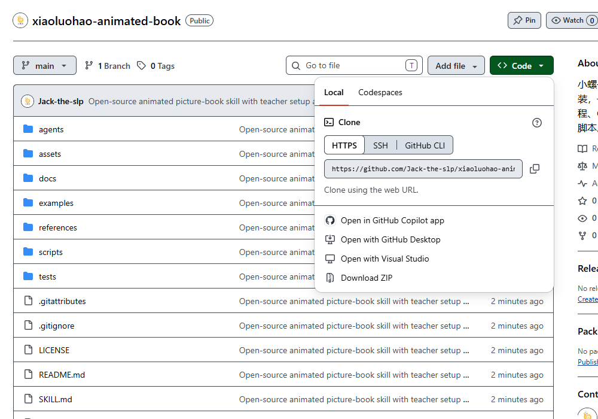

# 老师一步步安装：动画书 Skill

## 需要什么

各类 AI Agent 都可以使用这套流程，Codex 只是一个示例。先让你正在使用的 Agent 读取仓库，检查文件操作、命令执行、生图和导出工具，并按自己的技能机制安装或加载。只把文件发进普通网页聊天框，不等于安装到电脑。

- **体验现成小样：** 只需要现代浏览器。
- **生成 HTML：** Python 3.10 或更高版本和 Pillow。
- **做新的角色与动作：** AI 还需要有图片生成/编辑能力，或你提供可用且有权使用的连续动作图集。
- **生成动画 PPTX：** 使用 Agent 自己可用的 PPT 工具。仓库自带构建脚本使用 presentations 技能与 Artifact Tool 运行时，仓库不含这些依赖；其他工具可按相同要求制作。先检查导出能力，避免做到最后才发现不能交付。

## 路线 A：把链接丢给 AI 自动安装

### 1. 打开一个空的工作文件夹

例如在“文档”中新建“我的动画绘本”，在 AI 工具中打开它。新绘本和技能安装位置是两个不同目录。

### 2. 复制这段话

```text
请安装 https://github.com/Jack-the-slp/xiaoluohao-animated-book ，
先读仓库里的 aizidonganzhuangskill.md，按你自己的 Agent 环境安装或加载，保留已有同名技能，检查依赖，
运行随附的两动作小样，并告诉我实际安装位置和验证结果。
```

AI 应自行下载并检查仓库，不应要求你在聊天里粘贴密钥。安装本技能本身无需 GitHub 写入权限。

### 3. 核对安装结果

让 AI 给出实际安装或加载位置，确认 `SKILL.md` 与配套资源存在。各 Agent 的技能目录可能不同，不必照搬下面的 Codex 示例：

```text
Windows：C:\Users\你的用户名\.agents\skills\xiaoluohao-animated-book\SKILL.md
macOS/Linux：~/.agents/skills/xiaoluohao-animated-book/SKILL.md
```

Codex 现有环境也可能使用 `$CODEX_HOME/skills` 或 `~/.codex/skills`。安装器发现默认旧目录已有同名技能会停下，不会替你迁移。不要两处各放一份。其他 Agent 以自身配置为准；没有原生 Skills 目录时，也可完整保留仓库，让 Agent 读取 `SKILL.md` 后按流程执行。

路径依据：[OpenAI 官方安装文档中的 Agent Skills 目录表](https://developers.openai.com/api/reference/cli#use-the-cli-from-a-coding-agent)（核对日期：2026-11-10）。宿主配置与版本有差异时，以实际加载结果为准。

### 4. 先体验小样

AI 会运行：

```powershell
python scripts/demo.py --out "./我的动画书小样"
```

完成后打开输出目录里的单文件 HTML，先看恐龙跑步和跳远，再点“再看一次”、场景和翻页。文件夹版要整份保留，不能只复制 `index.html`。

### 5. 在下一轮说出主题

```text
用小螺号动画书 skill 做一本《小兔在幼儿园》，包括跑步、跳远、洗手、吃饭，
温暖水彩风，使用“谁／在哪里／做什么”三行短句，输出本地动画PPTX。
```

只说“一句话”不代表会立即生成完成：AI 要画动作、验收素材、合成、导出。第一次建议 1 个角色、2–4 个动作，先把一本书做完整。

## 路线 B：下载 ZIP，手动安装

### 1. 下载仓库

打开 [仓库首页](https://github.com/Jack-the-slp/xiaoluohao-animated-book)，点击绿色 **Code** 按钮，再点 **Download ZIP**。



### 2. 解压

在下载目录对 ZIP 选择“全部解压”。进入解压后的仓库文件夹，应能看到 `SKILL.md`、`scripts`、`assets`、`references`。

### 3. 检查 Python

在该文件夹打开终端，运行：

```powershell
python --version
```

应为 3.10 或更高。Windows 如果 `python` 不可用但 `py` 可用，把本教程命令开头的 `python` 改成 `py -3`。没有 Python 时，交给 AI 按你的系统安装或到 [Python 官网](https://www.python.org/downloads/)下载安装。

### 4. 运行本地安装器

```powershell
python scripts/install.py --dest "你的Agent实际使用的skills父目录"
```

先让 Agent 确认技能目录，再替换命令中的路径。只有确认 `~/.agents/skills` 适用时，才可以省略 `--dest`。没有原生 Skills 机制时可以跳过复制安装，保留完整仓库并让 Agent 读取 `SKILL.md`。安装器会列出实际路径与文件数，只复制本技能，不执行联网脚本、不申请管理员权限、不覆盖已有目标。已有同名目录时先停止并保留它。

### 5. 安装图片处理依赖并生成小样

```powershell
python -m pip install -r requirements.txt
python scripts/demo.py --out "./我的动画书小样"
```

依赖安装需要网络；小样构建使用仓库自带素材，不调用图片生成服务。

### 6. 回到 AI 工具

在下一轮说“用小螺号动画书 skill……”。支持技能快捷调用的工具用自己的语法，例如 Codex 的 `$xiaoluohao-animated-book`。未出现时重新打开会话，必要时重启工具。仍找不到时让 AI 核对技能搜索路径或读取仓库说明，别重复覆盖安装。

## 常见问题

**GIF 为什么在 PPT 编辑界面不动？** 先进入放映模式；编辑界面的静帧不能证明动画丢失。不同播放器表现需要分别验证。

**AI 说缺少 presentations 或 Artifact Tool。** 当前环境无法执行仓库自带的 PPT 构建脚本，但可让 Agent 使用自身的 PPT 工具完成同样要求并验证。没有可用导出工具时，再选择补齐相应环境或改为 HTML；不要下载来历不明的运行时。

**没有图片生成工具。** 可先运行现成小样；新题材需要接入可用生图工具或提供动作素材。这个 skill 不附送模型服务。

**能直接当教材使用吗？** 老师先检查句子、动作姿态、人物年龄、场景和道具是否一致，再根据学生情况调整。这里的文件与浏览器检查不证明教学或临床效果。

**怎么换自己的署名？** 告诉 AI 使用你的 Logo 和署名；`book.json` 中可设置 `logo`、`footerText`、`footerAddress`。不要暗示未经授权的机构背书。

**安装遇到“目标已存在”。** 安装器在保护旧版本。让 AI 比较新旧内容，确定更新方案；不要直接删除已有文件夹。
